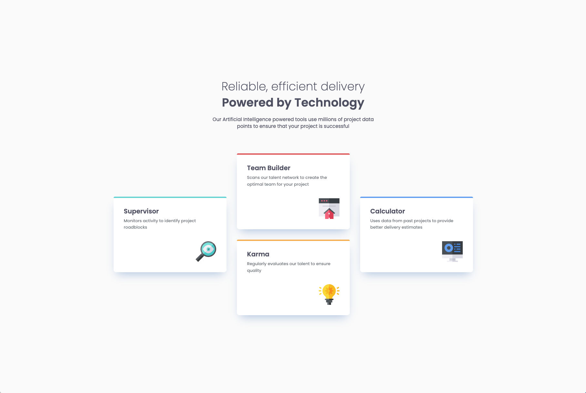

# Frontend Mentor - Four card feature section solution

This is a solution to the [Four card feature section challenge on Frontend Mentor](https://www.frontendmentor.io/challenges/four-card-feature-section-weK1eFYK). Frontend Mentor challenges help you improve your coding skills by building realistic projects. 

## Table of contents

- [Overview](#overview)
  - [The challenge](#the-challenge)
  - [Screenshot](#screenshot)
  - [Links](#links)
- [My process](#my-process)
  - [Built with](#built-with)
  - [What I learned](#what-i-learned)
  - [Continued development](#continued-development)


## Overview

### The challenge

Users should be able to:

- View the optimal layout for the site depending on their device's screen size

### Screenshot



### Links

- Solution URL: https://github.com/KingRocko/Four-card-feature-section
- Live Site URL: https://kingrocko.github.io/Four-card-feature-section

## My process

### Built with

- Semantic HTML5 markup
- CSS custom properties
- Flexbox
- CSS Grid
- Mobile-first workflow

### What I learned

I practised using `grid-template-areas` to create three responsive layouts: a single-column layout for mobile, an intermediate two-column layout, and a three-column desktop layout.

One challenge was making the columns stay equally wide as the viewport narrowed. I achieved this by explicitly defining the columns with `repeat()` and `minmax(0, 1fr)`:

```css
grid-template-columns: repeat(3, minmax(0, 1fr));
```

I also learned to choose breakpoints based on how the content behaves. I wanted the cards to have some room to shrink before switching to the next smaller layout, rather than changing the layout as soon as they became narrower than their maximum width.

Another challenge was creating the colored strip at the top of each card. With a top border, the card’s rounded corners also curved the inner edge of the strip. Instead, I used an absolutely positioned `::before` pseudo-element with a background color and rounded top corners. This kept the outer corners rounded while giving the strip a straight bottom edge:

```css
.card::before {
    content: "";
    position: absolute;
    inset: 0 0 auto;
    height: var(--space-050);
    border-radius: var(--border-radius-card) var(--border-radius-card) 0 0;
}

.card-supervisor::before {
    background: var(--color-border-card-supervisor);
}
```

### Continued development

I want to focus on deepening my understanding of CSS Grid and Flexbox. In future projects, I plan to practise controlling how elements grow, shrink, and align, and become more confident in deciding when to use each layout method and how to combine them. I also want to refine my approach to responsive layouts, particularly choosing breakpoints based on the content.